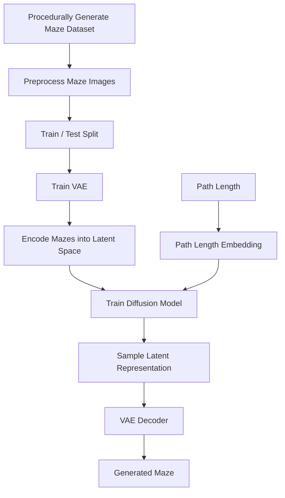

# Diffusion-Based Environment Generator

<p align="center">
  <strong>Procedural Maze Generation Using Conditional Latent Diffusion Models</strong>
</p>

<p align="center">
  Generate structured maze environments using Variational Autoencoders (VAEs) and Diffusion Models, with conditioning based on solution path length.
</p>

---

## Overview

**Diffusion-Based Environment Generator** is a generative machine learning project that explores the generation of maze-like environments using deep learning.

The project combines a **Variational Autoencoder (VAE)** with a **Denoising Diffusion Model** to learn the structure of maze environments and generate new samples in latent space. It also incorporates path-length conditioning, allowing the generation process to be guided by the structural complexity of a maze.

Instead of generating mazes directly in pixel space, the system learns a compressed latent representation and performs diffusion within that representation, enabling a more structured generative pipeline.

## Key Features

- **Procedural Maze Dataset Generation** — Generates a large synthetic dataset of maze environments for training.
- **Variational Autoencoder (VAE)** — Compresses maze images into a lower-dimensional latent representation and reconstructs them.
- **Latent Diffusion Model** — Learns to generate new maze representations by progressively denoising latent variables.
- **Path-Length Conditioning** — Incorporates maze solution path lengths into the generation process.
- **Multiple Path-Length Embeddings** — Supports different transformations of path length for conditioning:
  - Normal
  - Inverse
  - Exponential
  - Logarithmic
- **GPU Acceleration** — Supports CUDA acceleration when available, with CPU fallback.
- **Training and Evaluation Pipeline** — Includes model training, reconstruction evaluation, generation, and loss tracking.

---

## Model Architecture

The pipeline consists of two primary stages.

### 1. Variational Autoencoder (VAE)

The VAE learns a compact representation of maze environments.

- **Encoder:** Maps input maze images into a latent representation.
- **Latent Space:** Represents maze structure in a compressed form.
- **Decoder:** Reconstructs maze images from latent representations.

The VAE provides the latent space in which the diffusion model operates.

### 2. Latent Diffusion Model

A diffusion model is trained on the encoded maze representations.

During training, noise is progressively introduced into latent representations. A neural network learns to predict and remove this noise at different diffusion timesteps.

During inference, the model starts from noise and iteratively denoises it to produce a new latent representation, which is then decoded into a maze.

### 3. Path-Length Conditioning

The generation process incorporates path-length information to influence the structural properties of generated mazes.

Path length is transformed into a context embedding, which is supplied to the diffusion model during training and generation.

Supported embedding strategies:

| Embedding | Description |
|---|---|
| Normal | Direct path-length representation |
| Inverse | Inverse-transformed path-length representation |
| Exponential | Exponential transformation |
| Logarithmic | Log-transformed path-length representation |

This provides a mechanism to explore how conditioning influences the structure and complexity of generated environments.

---

## Pipeline



---

## Project Structure

```text
diffusion-based-environment-generator/
│
├── classifier_guidance/
│   └── models/
│       └── path_length_embedding.py
│
├── diffuser/
│   ├── encoder.py
│   ├── decoder.py
│   └── model.py
│
├── generator/
│   └── maze/
│       └── maze_generator.py
│
├── utils/
│   ├── maze_dataset.py
│   ├── data_preprocessor.py
│   └── ...
│
├── data/
│   ├── mazes/
│   ├── models/
│   └── train_losses.json
│
├── main.py
├── vae_trainer.py
├── unet_trainer.py
├── training_config.json
├── requirements.txt
│
└── README.md
```

---

## Dataset

The project uses procedurally generated maze environments as its training data.

The pipeline is designed to generate up to **100,000 maze samples**, which are processed and resized to a resolution of **32 × 32** before being used for model training.

Each maze is associated with a path-length value used for conditioning the generative model.

### Dataset Pipeline

1. Generate maze environments procedurally.
2. Convert generated environments into image representations.
3. Resize and preprocess the maze images.
4. Associate samples with their path-length information.
5. Split the dataset into training and testing subsets.
6. Load the processed data into PyTorch datasets and dataloaders.

---

## Installation

### Prerequisites

- Python 3.9+
- pip
- CUDA-compatible GPU (recommended, but optional)

### Clone the Repository

```bash
git clone https://github.com/Kavish718/diffusion-based-environment-generator.git

cd diffusion-based-environment-generator
```

### Install Dependencies

```bash
pip install -r requirements.txt
```

---

## Usage

### Training the Models

The main training pipeline is orchestrated through `main.py`.

```bash
python main.py
```

The pipeline is designed to:

1. Generate the maze dataset if it does not already exist.
2. Load and preprocess the maze data.
3. Create training and testing splits.
4. Train the VAE.
5. Train the diffusion model using latent representations.
6. Evaluate the generative model.
7. Save model checkpoints and training losses.
8. Visualize generated and original maze samples.

### Model Outputs

Training artifacts are intended to be stored under the `data/` directory.

| Artifact | Description |
|---|---|
| VAE checkpoint | Stores encoder and decoder weights |
| Diffusion checkpoint | Stores trained diffusion model weights |
| Training losses | Stores training loss history for analysis |
| Generated mazes | Generated samples for qualitative evaluation |

---

## Configuration

Training parameters are managed through `training_config.json`.

Parameters include:

| Parameter | Description |
|---|---|
| `BATCH_SIZE` | Number of samples processed per training batch |
| `VAE_LEARNING_RATE` | Learning rate for VAE training |
| `VAE_EPOCHS` | Number of VAE training epochs |
| `VAE_LATENT_CHANNELS` | Number of channels in the VAE latent representation |
| `VAE_MODELS_SAVE_PATH` | VAE checkpoint filename |
| `UNET_EPOCHS` | Number of diffusion/UNet training epochs |
| `NUM_TIMESTEPS` | Number of diffusion timesteps |
| `UNET_LATENT_CHANNELS` | Latent channels used by the diffusion model |
| `UNET_MODELS_SAVE_PATH` | Diffusion checkpoint filename |
| `GUIDANCE_SCALE` | Guidance scale used during training |
| `PATH_EMBEDDING_CHOICE` | Path-length embedding strategy |

---

## Technologies Used

- **Python**
- **PyTorch**
- **Deep Learning**
- **Variational Autoencoders (VAEs)**
- **Denoising Diffusion Models**
- **U-Net**
- **Latent Space Modeling**
- **Procedural Generation**
- **Matplotlib**

